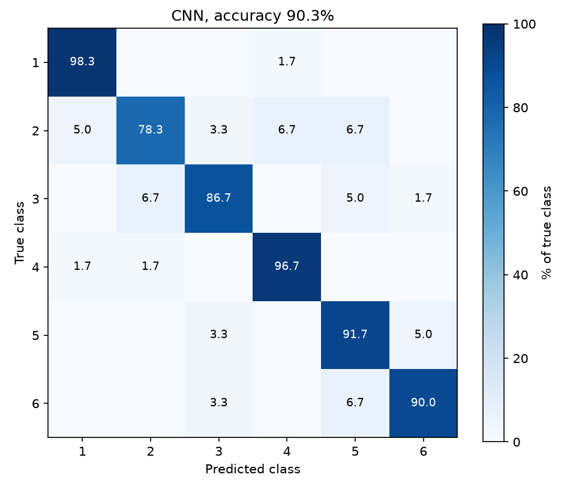
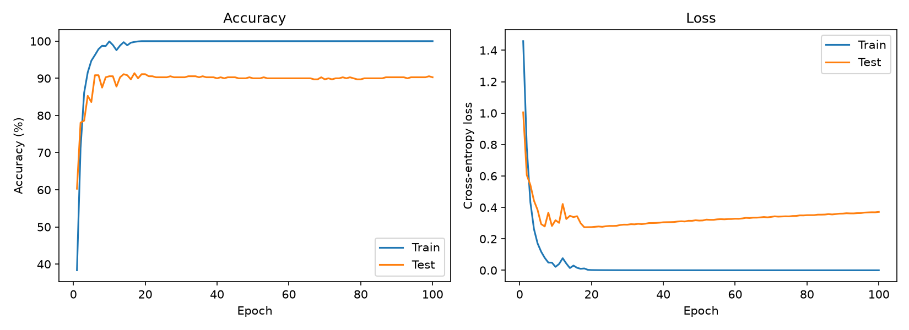

# auxetic-teng-cnn

A 1D convolutional neural network that recognises what a hand or robotic gripper is grasping, using only the voltage signal from a flexible triboelectric nanogenerator (TENG) sensor.

Each grasp presses the sensor's two films together and pulls them apart, which produces a pair of voltage pulses. How tall, wide and closely spaced those pulses are depends on the grasp. The network learns these patterns directly from the raw waveform and classifies each 2-second window into one of six grasps.

## How it works

**1. Simulating the sensor.** `teng_signals.py` models a 5 × 5 cm contact-separation TENG (FEP and CA/PEI films). The gap-dependent open-circuit voltage `V_oc(x)` and capacitance `C(x)` come from a COMSOL electrostatic simulation (`data/comsol_fe_voc_c_vs_gap.csv`). The voltage across a 100 MΩ load is found by integrating the circuit equation:

```
R · dQ/dt = V_oc(x) − Q / C(x)
```

**2. Generating grasps.** Each class has its own contact force, press speed, hold time and rhythm.

| Class | Grasp | Distinguishing features |
| --- | --- | --- |
| 1 | Hand, light touch | Low charge, slow press, irregular timing |
| 2 | Hand, fist | Medium charge, longer hold |
| 3 | Hand, orange | High charge, slow rhythm |
| 4 | Gripper, empty | Low charge, fast and regular |
| 5 | Gripper, orange | Medium charge, fast and regular |
| 6 | Gripper, apple | High charge, fast and regular |

Hand and gripper classes share amplitude levels in pairs, so the model has to use the timing and shape of the pulses, not just their height. Random variation, sensor noise, 50 Hz mains hum and baseline drift are added to every signal.

**3. Classifying.** `model.py` defines the network:

```
Input (1 × 1024)
→ Conv1D 6 filters, k=5, ReLU → MaxPool /2
→ Conv1D 12 filters, k=5, ReLU → MaxPool /2
→ Conv1D 60 filters, k=5, ReLU
→ Flatten → Dense 60, ReLU → Dense 6, softmax
```

It is trained with Adam (learning rate 0.001), cross-entropy loss, batch size 32, for 100 epochs. For comparison, `train.py` also trains an RBF-kernel SVM and a 300-tree random forest on the same data.

## Dataset

Two ready-made datasets are in `data/`, each with 1,800 signals: 300 per class, 1024 samples at 500 Hz.

- `synthetic_grasp_auxetic.npz`: a well-conforming sensor with clean contact and low noise.
- `synthetic_grasp_non_auxetic.npz`: a sensor that loses contact, with weaker and more variable pulses and 2.5× the noise.

```python
import numpy as np
d = np.load("data/synthetic_grasp_auxetic.npz")
X, y = d["X"], d["y"]   # X: (1800, 1024) voltage in volts, y: class 0–5
```

## Results

On a held-out test set of 360 signals (auxetic sensor):

| Model | Accuracy | ROC AUC |
| --- | --- | --- |
| 1D-CNN | 90.3% | 0.994 |
| SVM (RBF) | 86.9% | 0.978 |
| Random forest | 72.2% | 0.925 |

The CNN recognises the light-touch and empty-gripper grasps almost perfectly. Most of its mistakes are between the mid-force grasps, whose pulse heights overlap. On the noisier non-auxetic sensor, accuracy drops to 56.4%, which shows how much signal quality matters.

| Confusion matrix | Training curves |
| --- | --- |
|  |  |

The network reaches 100% training accuracy within about 15 epochs while test loss starts rising, so it overfits. Dropout, weight decay or early stopping would be the natural next step.

More figures, including example signals, a t-SNE of the learned features and ROC curves, are in `results/`.

## Run it

```bash
pip install -r requirements.txt
python train.py --device auxetic        # or --device non_auxetic
```

`train.py` regenerates the dataset (seed 42), trains for 100 epochs on CPU (about 4 minutes), and writes figures and `metrics.json` to `results/<device>/`.

## Acknowledgement

The CNN layout follows the architecture described by Wang et al., *Nano-Micro Letters* 18:286 (2026).
